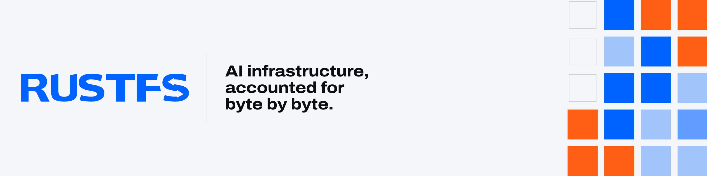

<picture>
  <source media="(prefers-color-scheme: dark)" srcset=".github/assets/banner-dark.png">
  
</picture>

# RustFS Design System

The official RustFS brand and design guidelines: logo, colour, typography, graphics, icons, data visualisation, motion and voice, with editable templates for advertising, article covers, slides, web, video, social and print. Every page is bilingual (`/en/`, `/zh/`); English is the default.

**Website:** https://design.rustfs.com · **Agent spec:** [`DESIGN.md`](DESIGN.md) (Google design.md format) · **Agent skill:** [`rustfs-brand`](skills/rustfs-brand/SKILL.md)

## Use with AI agents

Paste the prompt below into any coding or design agent, then replace the last line with your task. The agent reads the published spec and applies it.

```text
Read https://design.rustfs.com/DESIGN.md before you start and treat it as the source of truth for everything RustFS-branded in this task.

- Colour: use only the tokens it defines. Neutrals about 60%, Signal Blue #0062FF about 30%, Oxide #FF5E14 at most 10% with one focal point. No gradients, glows or other blues.
- Type and shape: Archivo for display, Geist for text, Geist Mono for labels; square corners everywhere.
- Logo: use the official SVG files unchanged (https://design.rustfs.com/brand/logo/rustfs-wordmark.svg on light surfaces, https://design.rustfs.com/brand/logo/rustfs-wordmark-white.svg on dark ones). Never retype or redraw the wordmark.
- Graphics: only the stripe signature and the shard matrix described in the spec.
- Copy: conclusion first; claims carry conditions, a source and a date; no superlatives. Always write the name as "RustFS".
- Before handing over, check the result against the "Do's and Don'ts" section and state any assumption you made.

Task: <deliverable, size in px, language, and the one message it carries>
```

Agents that support skills get the full workflow, templates and render scripts from the packaged skill. For Claude Code:

```bash
curl -LO https://design.rustfs.com/downloads/rustfs-brand.skill
unzip rustfs-brand.skill -d ~/.claude/skills/
```

## Stack

Next.js 16 (App Router, static export) · React 19 · Tailwind CSS v4 · shadcn/ui · pnpm. This matches rustfs.com and the Console.

## Commands

```bash
pnpm install
pnpm dev            # http://localhost:3000
pnpm tokens         # regenerate token files after editing tokens/tokens.json
pnpm skill          # regenerate tokens, sync the skill and package public/downloads/rustfs-brand.skill
pnpm build          # tokens + static export to out/
pnpm lint
pnpm typecheck
pnpm lint:design    # validate DESIGN.md with @google/design.md
```

## Structure

```text
tokens/tokens.json          single source of truth (W3C DTCG)
tokens/tailwind.css         generated Tailwind v4 theme, drop-in for shadcn/ui projects
tokens/tokens.css           generated CSS variables
DESIGN.md                   design spec for agents
skills/rustfs-brand/        agent skill (references, assets, scripts)
app/[locale]/<page>/        guideline and template pages
components/brand/           wordmark, symbol, icons, stripe, shard matrix, QR
components/artboard/        template artboards: fit, surface, language, edit, PNG export, presenter
components/site/            page primitives and interactive demos
public/brand/               logo SVG and PNG files
scripts/build-tokens.mjs    token generator and skill/download sync
```

## Editing rules

Read [CONTRIBUTING.md](CONTRIBUTING.md) before changing a page or adding a template. In short: the site is a public publication written as standards; every page is bilingual; templates measure in `u` (1/100 of the short side) and must work on every surface they list.

## Deployment

`pnpm run deploy` builds the static site to `out/` and publishes it to Cloudflare Workers static assets at https://design.rustfs.com (custom domain in `wrangler.jsonc`). Run `pnpm exec wrangler login` once first. Any static host can serve `out/` as well.

## License

The code and documentation in this repository are licensed under the [Apache License 2.0](LICENSE).

The RustFS name and logo are trademarks of RustFS, Inc. The Apache License 2.0 grants no rights to use them; see the terms of use on the [Downloads](https://design.rustfs.com/en/downloads/#terms) page.
